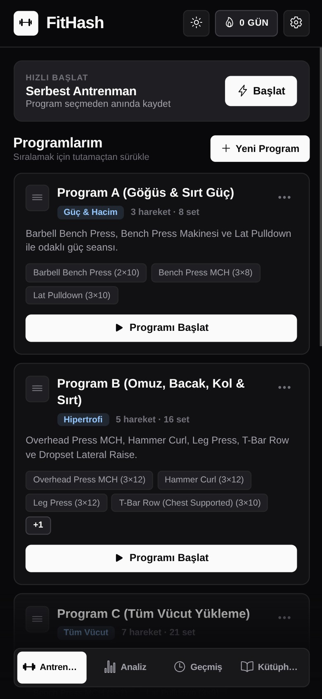
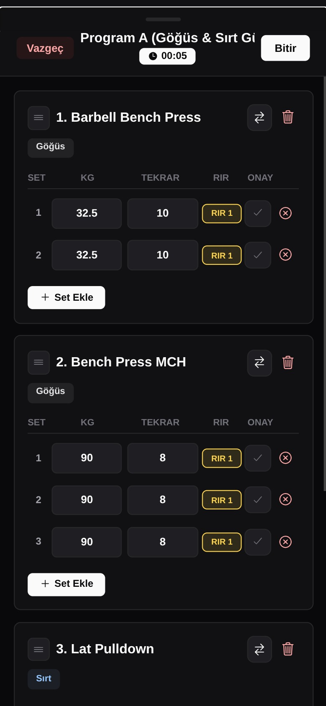
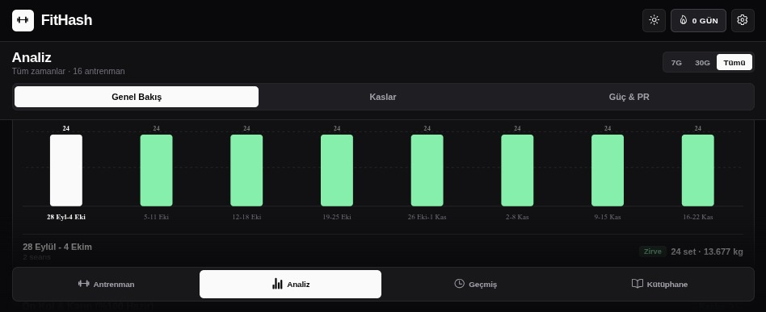
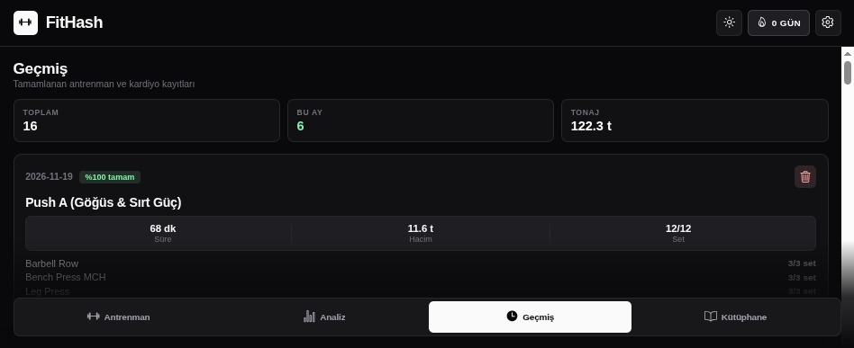
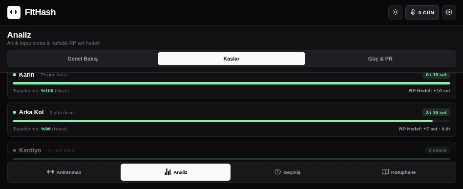
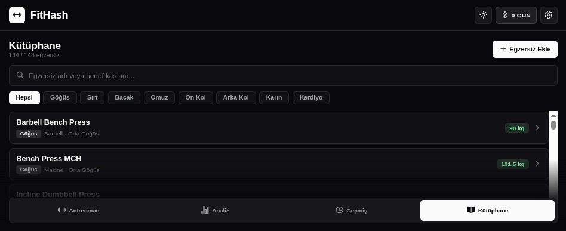

# FitHash 🏋️

**A local-first strength training tracker with a real progressive-overload engine — no account, no cloud, no subscription.**

FitHash is built for lifters who care about the numbers: autoregulated load progression, RIR-based effort tracking, muscle recovery modelling and volume landmarks, with everything stored on the device. A native **Wear OS** companion handles set logging and rest timers from the wrist, and **Health Connect** receives the sessions afterwards.


---

## Screenshots

<table>
  <tr>
    <td align="center"><br /><sub><b>Workout</b> — quick start, routines, drag to reorder</sub></td>
    <td align="center"><br /><sub><b>Active session</b> — sets, kg, reps, RIR</sub></td>
    <td align="center"><br /><sub><b>Analytics</b> — volume, splits, recovery</sub></td>
  </tr>
  <tr>
    <td align="center"><br /><sub><b>History</b> — every session, editable</sub></td>
    <td align="center"><br /><sub><b>Recovery</b> — readiness & weekly set targets</sub></td>
    <td align="center"><br /><sub><b>Library</b> — 144 exercises, PRs &amp; filters</sub></td>
  </tr>
</table>

<sub>Captured from the app running at a 390×844 viewport with eight weeks of demo training data.</sub>

---

## What makes it different

Most trackers log what you did. FitHash decides **what you should do next** — and shows its reasoning.

* **Autoregulated progression** — `calculateSmartAutoregulatedOverload` turns your last performance plus RIR into a concrete target for the next set, instead of a fixed "+2.5 kg every week".
* **Hypertrophy-aware rep brackets** — suggested loads respect the rep range you're training in (`getHypertrophyRepBracket`, `calculateLoadIncrement`), so a 5-rep strength set and a 15-rep pump set progress differently.
* **Plateau detection & deloads** — `detectPlateauAndDeload` flags stalled lifts and proposes backing off before you grind yourself into the ground.
* **e1RM from autoregulated data** — `calculateAutoregulatedE1RM` estimates your max from the RIR-adjusted set, not just raw weight × reps.
* **Volume landmarks per muscle** — `evaluateWeeklyMuscleVolumeLandmarks` tracks weekly sets against MEV/MAV-style landmarks and reports what is under- or over-trained.
* **Recovery modelling** — `muscleRecoveryService` applies a Hill-curve recovery estimate per muscle group, feeding the recovery heatmap so you can see what is ready today.
* **Local coach summary** — `generateLocalCoachAnalysis` writes the plain-language read on your week, computed on-device.
* **Biomechanical substitution** — `exerciseSubstitutionService` suggests alternatives by movement pattern, equipment and biomechanical profile when a machine is taken.

---

## Features

**Training**
* Session logging with kg, reps, RIR, warm-up sets and per-exercise rest timers
* Routine builder with drag-and-drop exercise ordering, superset-friendly grouping and free sessions
* In-workout exercise swap, add/remove sets, automatic PR detection
* Rest timer notifications that survive backgrounding, mirrored to the watch

**Analysis**
* SVG strength and volume progression charts (no chart-library bloat)
* Per-muscle weekly volume against landmarks, muscle-frequency and split breakdowns
* Recovery heatmap, streak tracking and weekly target history
* One-rep-max widget and per-exercise PR detail sheets

**Ecosystem**
* **Wear OS companion** (`android/wear`, Jetpack Compose for Wear) — standalone set logging, heart rate during sets, rest timer control, and a documented phone↔watch sync contract (`docs/WEAR_SYNC_PROTOCOL.md`)
* **Health Connect** — writes completed sessions, calories, heart rate and steps
* **Backup** — one-tap full JSON export/import of workouts, routines, PRs and settings
* **Themes** — dark (Zinc) and light (Swiss daylight) palettes designed at the token level

**Privacy**
Every workout lives in `AsyncStorage` on the phone. There is no backend, no login, no analytics SDK, and no network round-trip for training data.

---

## Tech stack

| Layer | Choice |
|---|---|
| Framework | React Native 0.81 + Expo SDK 54 |
| Language | TypeScript 5.3 |
| UI/graphics | React Native SVG, Expo Vector Icons, `expo-linear-gradient` |
| Storage | `@react-native-async-storage/async-storage` |
| Health | `react-native-health-connect` |
| Notifications | `expo-notifications` |
| Wearable | Native Android module, Jetpack Compose for Wear OS |
| Tests | Vitest (6 files, 156 tests) |

---

## Getting started

**Prerequisites:** Node 18+, npm, Android Studio with SDK 34+ (for native builds), JDK 17.

```bash
git clone git@github.com:ahasdemir/fithash.git
cd fithash
npm install
npm start          # Metro bundler
npm run android    # device or emulator
npm run web        # browser build (used for UI work)
```

### Build a release APK

```bash
cd android
./gradlew assembleRelease
# android/app/build/outputs/apk/release/app-release.apk
```

> The release variant is currently signed with the **debug keystore**, so it installs over an existing build but is not Play-Store ready. Swap in a real keystore before publishing.

### Tests

```bash
npx vitest run     # 156 tests
npx tsc --noEmit   # type check
```

---

## Project structure

```
fithash/
├── App.tsx                    # Root: tabs, active session, settings modals
├── src/
│   ├── components/            # Charts, modals, drag list, rest timer, cards
│   ├── screens/               # Workout / Analytics / History / Library / Settings
│   ├── services/
│   │   ├── progressionEngine.ts        # e1RM, overload, deload, landmarks, coach
│   │   ├── muscleRecoveryService.ts    # Hill-curve recovery model
│   │   ├── exerciseSubstitutionService.ts
│   │   ├── healthConnectService.ts
│   │   ├── wearSyncService.ts
│   │   ├── notifications.ts
│   │   └── storage.ts                  # AsyncStorage schema + backup
│   ├── data/exerciseLibrary.ts         # Exercise DB with biomechanical tags
│   ├── types/fitness.ts                # Session, set, routine, PR schemas
│   ├── theme/                          # Token-based dark/light palettes
│   └── utils/dragReorder.ts            # Reorder maths for the drag list
├── android/
│   ├── app/                   # React Native host
│   └── wear/                  # Wear OS companion module
├── docs/                      # Specs + evidence base: wear sync, biomechanics, taxonomy, audits
└── tests/                     # Vitest suites
```

---

## Design notes

* **One source of truth for training maths.** Progression, deload and volume logic live in `services/progressionEngine.ts` as pure functions, so they are testable and shared by the UI and the coach summary.
* **The UI is Turkish.** Exercise names stay in their original form; the chrome is localised for the target user.
* **Specs before code.** `docs/` holds the wear-sync protocol, the hypertrophy/autoregulation model and the muscle taxonomy the services implement.
* **Evidence before claims.** `docs/EXERCISE_SCIENCE_RESEARCH.md` grades the evidence behind every training rule the app encodes (A–D), audits the shipped implementation against it, and lists where the product asserts more precision than the literature supports.
* **No chart library.** Charts are hand-built SVG components using theme tokens, which keeps the bundle small and the visual language consistent.

---

## Roadmap

* Migration to Expo SDK 57 (`docs/EXPO_SDK57_MIGRATION_PLAN.md`)
* Exercise media (form clips) with a local cache
* Per-muscle mesocycle planner built on the volume-landmark service

---

## License

MIT — personal project, issues and pull requests welcome.

**Author:** Ahmet Hasdemir · [GitHub](https://github.com/ahasdemir)
